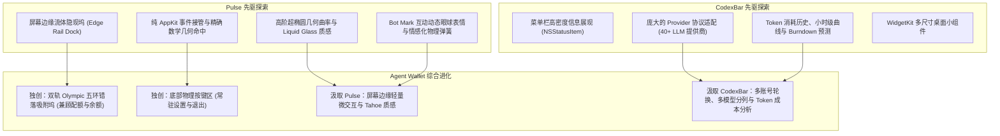
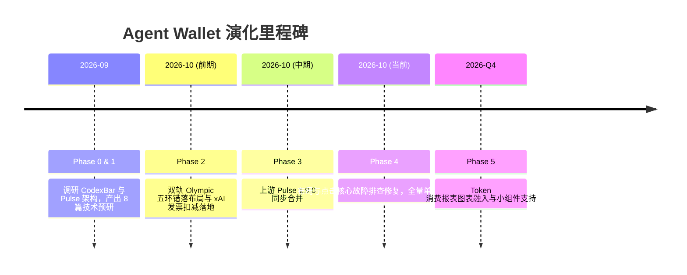

# Agent Wallet 演进路线图与全景学习路径 (Roadmap & Learning Journey)

> 本文档详细记录了 Agent Wallet 从立项探索、技术选型、吸收两款先驱产品（CodexBar 与 Pulse）精华、演化出独创的“双轨 Olympic 五环坞”，到后续规划的完整路线图与工程实践经验。

---

## 1. 项目缘起与定位 (Origin & Vision)

随着大语言模型（LLM）驱动的编程智能体（Claude Code、Codex、Cursor、Antigravity、Windsurf 等）成为日常开发的核心生产力工具，开发者面临着前所未有的“AI 资产与算力管理”难题：

1. **配额黑盒与重置焦虑**：不同工具的限制策略各不相同——有的以 5 小时为窗口滚动限制（如 Claude Code），有的以每周 Token 总量为限（如 Codex），有的支持多模型独立配额（如 Antigravity）。
2. **算力资产形式的分裂**：市场上主要有两种计费形态：
   - **配额型（Quota-based）**：包月订阅，随时间周期滚动重置（如 Claude Pro/Team、GitHub Copilot、Cursor）。
   - **余额/发票扣减型（Money/Balance-based）**：按量计费，需实时监控账户法币余额、发票账单与每日消耗速度（如 DeepSeek 充值余额、OpenAI API、xAI 账单）。
3. **传统工具的局限**：
   - 多数状态栏小工具仅仅是展示单个模型的百分比，或者在多提供商时导致菜单栏被极度挤占。
   - 缺少一个既有极致审美、边缘轻量无感隐现，又能承载混合计费资产的**“AI 算力资产钱包”**。

**Agent Wallet 的核心定位**：专为重度 AI 开发者打造的 macOS 原生算力资产管理面板。不仅做配额监控，更做开发者的 AI 资产“数字钱包”。

---

## 2. 核心先驱工程拆解与经验汲取 (Deep Dive: CodexBar & Pulse)

在构建 Agent Wallet 的过程中，团队深入调研并逆向剖析了两款优秀的开源先驱：**CodexBar** 和 **Pulse**。



### 2.1 CodexBar (steipete/CodexBar) 的架构经验与反思

#### 核心亮点与资产
- **高密度数据分析**：CodexBar 针对 API 计费型模型设计了完善的消费分析体系，包含今日、7天、30天以及全部周期的 Token 消耗统计、分时速率、Burndown 预测图表，支持 CSV/JSON 导出。
- **丰富的提供商矩阵**：支持包括 Codex、Claude、OpenAI、DeepSeek、Zhipu、Kimi、MiniMax、Grok、OpenRouter 等在内的 40 多个提供商。
- **WidgetKit 支持**：原生开发了三种规格（Compact、Wide、Large）的桌面小组件，方便在桌面上快捷监控。
- **资产存档位置**：全套设计规范、小组件设计草图、面板截图均已归档至 [Docs/reference/codexbar/](file:///Users/richard_seong/Developer/Personal/agent-wallet/AgentWallet/Docs/reference/codexbar/)。

#### 局限与工程反思
- **菜单栏物理空间拥挤**：macOS 菜单栏（尤其是带刘海 MacBook）在开启多应用后极易被折叠隐藏，当用户开启多个模型时，菜单栏图标准备空间严重不足。
- **UI 质感偏向传统表单**：菜单栏下拉列表信息虽然详实，但在日常工作流中缺乏动态趣味感与现代流体质感。
- **轮询能耗风险**：多账户高频背景轮询若没有完善的节流与休眠退避策略，会对电池续航产生负担。

---

### 2.2 Pulse (qunqin24/Pulse) 的架构经验与反思

#### 核心亮点与资产
- **革命性的屏幕边缘微交互**：摒弃状态栏，将面板固定在屏幕左/右/上边缘。平时缩为一条近乎隐形的极细微缝（Collapsed Sliver），鼠标移入即丝滑展开为悬浮坞（Hover Rail），彻底释放菜单栏空间。
- **精雕细琢的几何美学**：
  - 坞末端采用第 4 阶超椭圆（Superellipse）或半圆倒角，与屏幕边缘通过严谨的 S-curve 切线无缝连接。
  - 支持 macOS Tahoe 风格的 Liquid Glass 玻璃折射材质。
  - 双环进度条：外环长周期配额（细线条光晕），内环短周期配额（醒目粗线条）。
- **动效与情感化交互**：独特的 Bot Mark 交互表情，小机器人的眼睛会实时跟踪鼠标指针移动，并在配额重置、工作完成时做出眨眼和动态反馈。
- **纯 AppKit 事件接管**：针对无激活浮动面板（`NSPanel` + `.nonactivatingPanel`），通过重写 `sendEvent` 进行原生事件分发，避免了 SwiftUI 容器内部点击事件被吞噬的问题。

#### 局限与工程反思
- **单轨线性设计的局限**：Pulse 原生仅支持单列环形排列。当用户同时配置了多个配额模型与充值扣费模型时，单列过长会超出笔记本屏幕垂直可视高度。
- **资产形态单一**：Pulse 专为配额百分比设计，对以“金额数字（¥/$)、充值余额、按量发票扣减”为核心的模型缺乏深度适配。

---

## 3. Agent Wallet 的核心技术突破 (Agent Wallet Innovations)

Agent Wallet 在两者的基础上，实现了关键的技术创新与架构整合：

### 3.1 双轨 Olympic 五环错落坞 (Dual-Track Olympic Dock)

为了完美解决“时间配额”与“金额资产”共存的问题，Agent Wallet 设计了双轨错落排列架构：

1. **左轨（配额轨 Quota Track）**：
   - 承载 Claude Code、Cursor、Antigravity、GitHub Copilot 等时间周期配额模型。
   - 使用紧凑双环展现（外环 5 小时短周期，内环 7 天长周期）。
2. **右轨（消费/余额轨 Money Track）**：
   - 承载 DeepSeek、OpenAI、xAI 等充值余额与按量扣减模型。
   - 数字标签展示法币余额（如 `¥28.5`、`$12.0`），环形指示近 30 天预算消耗比例。
3. **错落交织算法（Olympic Staggered Math）**：
   - 借鉴奥运五环的错落排布哲学，右轨相对于左轨沿轴向偏移半个步长（`+ 0.5 * step`）。
   - 两列环形交错分布，标签与圆环各居其位，互不碰撞遮挡。
   - 轨宽由单轨 64pt 自适应扩展至双轨 120pt，沿轴长度缩短近 40%，完美适配笔记本屏幕。

```
     左轨 (配额 Quota)               右轨 (金额 Money)
    +-----------------------------------------------+
    |   [ Claude 环 ]                               |
    |      82%                                      |
    |                     [ DeepSeek 余额环 ]       |
    |                           ¥45.2               |
    |   [ Cursor 环 ]                               |
    |      65%                                      |
    |                     [ xAI 发票额度环 ]        |
    |                           $18.0               |
    |                                               |
    |            [ ⚙ 设置 ]   [ ⏻ 退出 ]            |
    +-----------------------------------------------+
```

### 3.2 底部常驻物理动作栏 (Action Bar)

以往版本缺乏退出与设置的直观物理入口，用户常迷失在快捷键中。Agent Wallet 在坞的底部开辟了独立的动作控制区：
- **常驻双键**：齿轮（`Settings…`）与电源（`Quit`）。
- **物理命中判定**：在 `FloatingPanelController` 中直接计算两按键的绝对坐标圆域（半径 20pt），在 AppKit 层面拦截点击并触发 `showSettings()` 或 `terminate(nil)`，响应速度达 0ms 延迟。

### 3.3 Antigravity 双模型分列支持 (Model Group Splitting)

针对 Google Antigravity 等高级多智能体工作台，单一账号往往同时包含两组截然不同的模型配额（Gemini 模型组 与 Claude/GPT 代理组）。Agent Wallet 原生支持将其拆分为独立的双环槽位（`RailSlot`），各槽位独立跟踪配额与重置时间。

---

## 4. 全景演进历程与经验复盘 (Evolution & Postmortems)



### 4.1 关键故障复盘：1.9.0 同步回退问题 (Postmortem)
- **事件**：在合入上游 Pulse 1.9.0 的新特性（如 Liquid Glass 优化、多显示器跟踪重构）时，误将 `FloatingPanelController` 和 `UsageDockView` 中 Agent Wallet 特有的双轨窗口尺寸计算、按键区域计算以及点击分发代码覆盖回了单轨版本。
- **影响**：
  1. 窗口物理边界被裁剪为 64pt 宽，底部动作区域丢失 88pt 高度，导致设置与退出键无法显示。
  2. 点击齿轮图标被当做普通配额环处理且命中失败，模态设置窗口无法唤出。
  3. 双轨第 2 列的金额模型因缺失 `isMoney` 坐标偏移判定而失效。
- **解决方案与防守措施**：
  - 在 `FloatingPanelController.swift` 中重新绑定 `maximumThickness`、`shownRailSize` 以及 `actionPositions` 点击分发。
  - 在 `UsageDockView.swift` 的单轨保护分支中加入 `+ actionAreaLength`。
  - 在 `AppDelegate.swift` 中加上完整的窗口呼起机制与 `@MainActor` 签名校验。
  - 编写了专门的 `DualTrackOlympicRailGeometryTests` 单元测试，将按键必须处于坞物理边界内作为自动化断言，防范未来再次合并上游代码时出现回归。

---

## 5. 页面级与组件级工程实现图鉴 (Component & Page Catalog)

| 页面 / 组件 | 核心职责 | 实现文件 | 关键技术机制 |
| :--- | :--- | :--- | :--- |
| **边缘吸附坞 (Edge Rail)** | 展现全部配额与金额环形状态，负责屏幕边缘隐现 | [`UsageDockView.swift`](file:///Users/richard_seong/Developer/Personal/agent-wallet/AgentWallet/Sources/Pulse/Panel/UsageDockView.swift) | `DockBerthShape` 超椭圆绘制、Olympic 双轨错落布局算法 |
| **浮动面板主控制器** | 管理原生非激活窗口（`NSPanel`），接管全局指针事件 | [`FloatingPanelController.swift`](file:///Users/richard_seong/Developer/Personal/agent-wallet/AgentWallet/Sources/Pulse/Panel/FloatingPanelController.swift) | `PanelHitArea` 纯数学几何命中、`ActiveDisplayFollower` 跨屏幕跟随 |
| **底部动作控制栏 (Action Bar)** | 提供设置与退出快捷操作 | [`UsageDockView.swift`](file:///Users/richard_seong/Developer/Personal/agent-wallet/AgentWallet/Sources/Pulse/Panel/UsageDockView.swift) | `actionPositions` 坐标解算、`railButton` 悬停微动效 |
| **详情卡片模态 (Detail Card)** | 展开显示选定提供商的全部周期窗口、重置倒计时与账单 | [`DetailCardView.swift`](file:///Users/richard_seong/Developer/Personal/agent-wallet/AgentWallet/Sources/Pulse/Panel/DetailCardView.swift) | 动态高度自适应、重置时间国际化模版、多模型配额分解 |
| **设置窗口 (Settings Window)** | 配置提供商连接、外观风格、快捷键、声音警报 | [`SettingsView.swift`](file:///Users/richard_seong/Developer/Personal/agent-wallet/AgentWallet/Sources/Pulse/Settings/SettingsView.swift) | 多标签分页（General, Providers, Appearance, Shortcuts, Alerts, Spend） |
| **Bot Mark 情感化组件** | 萌系小机器人表情，目光跟随指针 | [`BotMarkView.swift`](file:///Users/richard_seong/Developer/Personal/agent-wallet/AgentWallet/Sources/Pulse/Panel/BotMarkView.swift) | 空间坐标转换（`coordinateSpace`）、眼球注视角度三角函数计算 |

---

## 6. 后续演进路线图 (Future Roadmap)

### Milestone 1: 工程标准化与空间瘦身 (当前阶段)
- [x] 修复底部设置/退出按键与双轨模型命中问题。
- [x] 将前期研发文档与 CodexBar 关键资产完整转录归档至 `Docs/research/` 与 `Docs/reference/`。
- [x] 整理演进全景路线图与学习路径规范文档。
- [ ] 移除根目录下冗余的 `CodexBar/`、`Pulse/` 及 `research/` 原始目录，释放约 391 MB 空间，使项目保持极致精简。

### Milestone 2: 算力消费报表深度融合 (2026 Q4)
- [ ] 吸收 CodexBar 的 SQLite 消费流水记录能力，在详情卡片中增加近 7 天 / 30 天算力扣减折线图。
- [ ] 增加 Token 消耗速度预测（Burn-down 速率），提供配额耗尽预警推演。

### Milestone 3: 桌面小组件系统 (WidgetKit)
- [ ] 复用 CodexBar 的小组件设计灵感，开发适用于 macOS 桌面与通知中心的小组件。
- [ ] 支持在桌面上直观监控主力模型的配额重置倒计时。

### Milestone 4: 更多智能体生态扩展
- [ ] 接入 Claude Enterprise、Gemini CLI 原生凭证捕获。
- [ ] 支持本地模型服务（Ollama / LMStudio）的并发通道与上下文占用监控。
