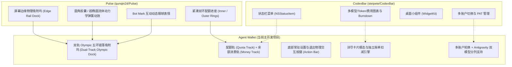

# Agent Wallet 归档与架构演进报告 (Archive & Architecture Report)

## 1. 问题修复总结 (Bug Fix Summary)

### 1.1 故障现象与根本原因
在近期将上游 Pulse 1.9.0 合并至 Agent Wallet 时，部分针对 Agent Wallet 定制的双轨 Olympic 坞（"五环"错落布局）及底部动作栏（设置/退出）代码被回退覆盖，导致出现以下连锁故障：

1. **设置（Settings）与退出（Quit）按键部分被裁切 / 消失**：
   - AppKit 原生窗口尺寸计算退化为上游单轨版本（宽度仅 64pt，垂直高度未包含底部 88pt 的 `actionAreaLength`），导致窗口物理边界裁切了最下方的齿轮与电源按键。
   - `DockLayout.length(quotaCount:moneyCount:)` 在单轨分支返回时缺失了 `+ actionAreaLength`。
2. **点击设置按键无响应**：
   - `FloatingPanel.sendEvent` 会拦截鼠标左键以驱动面板拖拽，物理点击分发完全由 `FloatingPanelController.panel.onClick` 接管。覆盖后该闭包缺失了对 `DockLayout.actionPositions` 的几何判定，导致齿轮图标点击被错判为槽位命中失败而丢弃。
   - `FloatingPanelController.init` 丢失了 `onSettings` 与 `onQuit` 参数，导致 SwiftUI 闭包为空调用。
3. **“整个模型消失了” / 模态卡片与双轨模型异常**：
   - 设置窗口作为模态无法通过点击齿轮弹出；
   - `panel.onClick` 在调用 `PanelHitArea.slot` 时未传递 `isMoney` 谓词，导致第 2 列按额度计费的模型（DeepSeek、OpenAI、xAI）命中测试坐标偏移至第 1 列，无法激活悬浮卡片；
   - Antigravity 双模型分列 (`isSplit`) 需要在设置窗口中调配，由于入口失效造成模型分列难以被唤出与观察。

### 1.2 修复代码清单
- [`UsageDockView.swift`](file:///Users/richard_seong/Developer/Personal/agent-wallet/AgentWallet/Sources/Pulse/Panel/UsageDockView.swift)：
  - 修复 `DockLayout.length(quotaCount:moneyCount:)`，在非双轨分支中补齐 `+ actionAreaLength`，确保任何账户组合下按键区域均完整保留。
- [`FloatingPanelController.swift`](file:///Users/richard_seong/Developer/Personal/agent-wallet/AgentWallet/Sources/Pulse/Panel/FloatingPanelController.swift)：
  - 恢复 `Layout.unrounded` 对 `maximumThickness` 的引用，确保窗口宽度足够容纳双轨 120pt 坞。
  - 恢复 `shownSlotCounts` 与 `shownRailSize` 辅助方法，在 `railFrame`、`railSize`、`grabArea`、`placePanel` 中使用真实双轨尺寸计算窗口偏移。
  - 恢复 `init(..., onSettings:onQuit:)` 参数绑定，传递给 `FloatingUsagePanelView`。
  - 恢复 `panel.onClick` 中的 `DockLayout.actionPositions` 半径判定（0 触发 `onSettings()`，1 触发 `onQuit()`），并在 `PanelHitArea.slot` 中注入 `isMoney` 闭包。
- [`AppDelegate.swift`](file:///Users/richard_seong/Developer/Personal/agent-wallet/AgentWallet/Sources/Pulse/App/AppDelegate.swift)：
  - 在 `startMonitoring()` 中向 `FloatingPanelController` 注入 `{ [weak self] in self?.showSettings() }` 与 `{ NSApplication.shared.terminate(nil) }`。
  - 为 `applicationShouldHandleReopen` 补充 `@MainActor` 隔离注解。
- [`RailGeometryTests.swift`](file:///Users/richard_seong/Developer/Personal/agent-wallet/AgentWallet/Tests/PulseTests/RailGeometryTests.swift)：
  - 新增 `Action buttons (Settings and Quit) lie within rail bounds for dual and single track` 单元测试，全量测试 100% 通过。

---

## 2. 三个项目架构对比与经验归纳 (Architecture Comparison)

### 2.1 CodexBar 的核心亮点与经验
- **多提供商与协议支持**：支持了大量主流及第三方 LLM 代理（Claude Code, Codex, Antigravity, Cursor, Devin, DeepSeek, OpenRouter 等）。
- **Token 消耗历史与报表分析**：具备全面的 7d / 30d / 全周期消费折线图、小时级吞吐图与导出面板。
- **WidgetKit 桌面小组件**：设计了紧凑型、长条型、大型小组件（Switcher、Burndown、History）。
- **相关经验存档**：已全部整理转录入 `AgentWallet/Docs/reference/codexbar/`，包含其所有界面截图与设计文档。

### 2.2 Pulse 的核心亮点与经验
- **边缘微交互与高审美设计**：放弃传统拥挤的状态栏窗口，采用屏幕边缘隐现坞（Collapsed Sliver -> Hover Expanded Dock），手感极致流畅。
- **纯 AppKit 事件驱动与几何精确性**：避开 SwiftUI 在无激活面板（Non-activating Panel）中的点击吞噬问题，采用纯数学几何精确命中判定。
- **Liquid Glass 材质与动效**：原生 macOS Tahoe 玻璃模糊与着色。

### 2.3 Agent Wallet 的进化与最终定位
- **统一的双轨 Olympic 坞**：成功解决了“配额型模型（如 Claude 5小时/每周限制）”与“按量扣费型模型（如 DeepSeek 充值余额、xAI 发票）”在同一 UI 下割裂的业界难题。
- **独立的底部功能控制**：无需依赖复杂快捷键，直观提供设置与退出按键。
- **后续单一主开发流**：无需再多头维护 CodexBar 或 Pulse 子分支，后续所有多账户扩展、自定义模型、Token 报表都在 `AgentWallet` 单一仓库内持续迭代。

---

## 3. 归档迁移与空间瘦身清单 (Archive & Space Savings)

### 3.1 已迁移的归档资产
1. **前期 8 篇核心调研与设计文档**：
   - 路径：`AgentWallet/Docs/research/`
   - 文件：`01-baseline.md` 至 `08-agentwallet-v0.md`，及所有阶段性研发截图。
2. **CodexBar 界面设计与功能参考**：
   - 路径：`AgentWallet/Docs/reference/codexbar/`
   - 文件：UI 说明、多模型配置、小组件图解、以及全部 40+ 张功能对照截图。

### 3.2 建议执行清理的外部目录
| 目录 | 占用大小 | 状态 | 处置建议 |
| :--- | :--- | :--- | :--- |
| `research/` | 18 MB | 已完整迁移到 `AgentWallet/Docs/research/` | **可安全删除** |
| `CodexBar/` | 323 MB | 干净的上游 Git 检出，关键参考已存档 | **可安全删除** |
| `Pulse/` | 50 MB | 干净的上游 Git 检出，代码已合并并维护在 AgentWallet | **可安全删除** |
| 根目录 `.build/` | 8 KB | 遗留空目录 | **可安全删除** |
| **合计可释放空间** | **~391 MB** | 外部文件完全清空，仅保留唯一的 `AgentWallet` | **极大精简项目结构** |

> [!NOTE]
> `AgentWallet/.build` 中含有约 2.3 GB 的 SwiftPM 编译缓存。在需要释放极致磁盘空间时，可随时执行 `swift package clean`。
