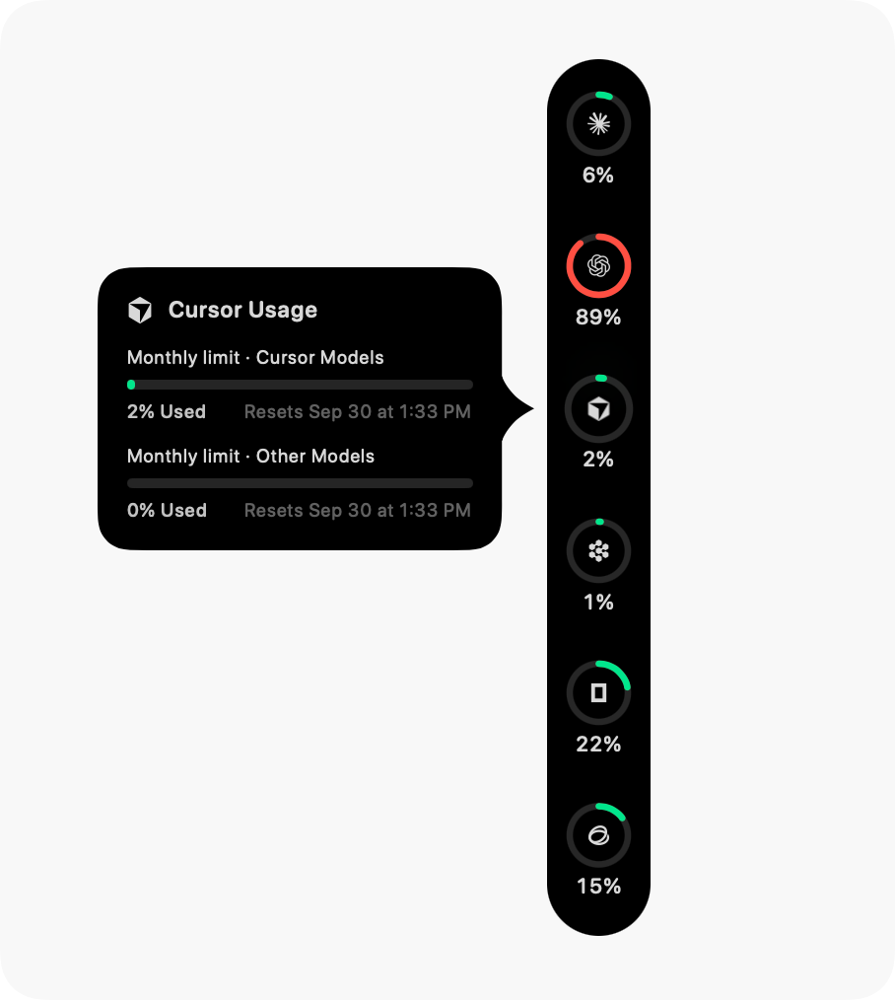
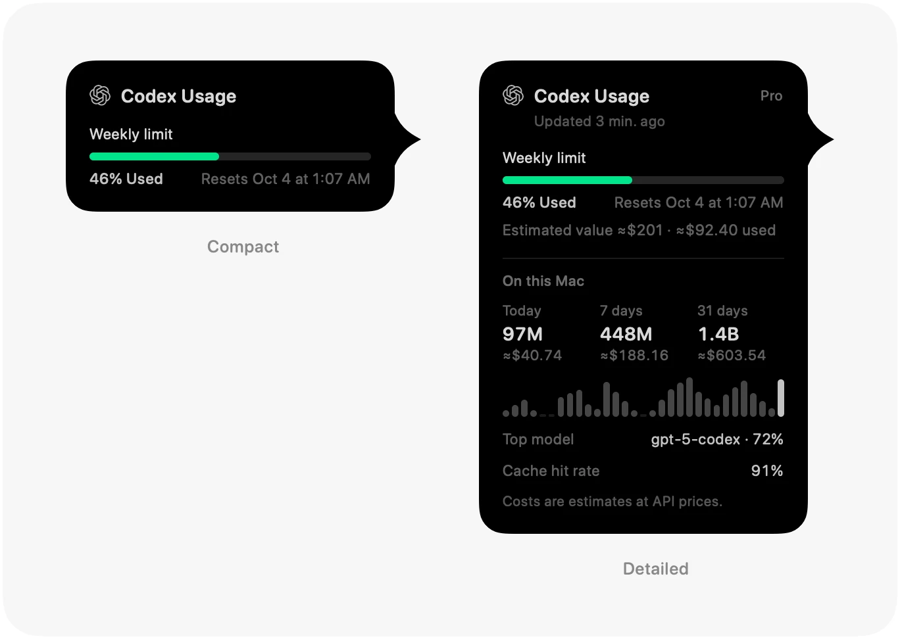

<p align="center">
  
</p>

<h1 align="center">Agent Wallet</h1>

<p align="center">
  <b>AI の計算資源のためのウォレット。コーディング用の枠と API 残高の残りを、画面の端でひと目で確認できます。</b><br>
  すでに使っているアカウントを読み取り、1 つにつきリング 1 つで表示する macOS アプリです。残りを先に見せ、枠と残高は列を分けて並べます。
</p>

<p align="center">
  <a href="LICENSE"></a>
  
  <a href="https://github.com/Violet-Amethyst/agent-wallet/commits"></a>
</p>

<p align="center">
  <sub><b>macOS 14 Sonoma 以降</b> · Apple シリコン / Intel 両対応 · <a href="README.md"><b>English</b></a> · <a href="README.zh-CN.md"><b>简体中文</b></a> · <a href="README.zh-Hant.md"><b>繁體中文</b></a> · <b>日本語</b> · <a href="README.ko.md"><b>한국어</b></a></sub>
</p>

<p align="center">
  
  &nbsp;&nbsp;
  
</p>

<p align="center">
  <sub>スクリーンショットは Pulse をベースにした時点のものです。このプロジェクトの Dock は残りで表示し、枠と残高を分けて並べます（下記）。</sub>
</p>

## これは何か

Agent Wallet は、[Pulse](https://github.com/qunqin24/Pulse) のソースをもとに、個人で独立して保守しているプロジェクトです。使用量の読み取り方は Pulse を引き継いでいます。各サービス自身のエンドポイントを使い、すでにあるログインを利用し、こちらのサーバーには何も送りません。変えたのは、数値の見せ方と、読み取れるアカウントの種類です。

- **残りを先に** — Dock には、あとどれだけ使えるかを表示します。短いウィンドウ（約 5 時間）が内側のリング、長いウィンドウ（1 週間または 1 か月）が外側のリングで、リングの下の文字が残りです。
- **枠と残高を別の列に** — サブスクリプションの枠を片側に、プリペイドや従量課金の残高をもう片側に置きます。区切り線を挟んだ 1 列にもできます。**設定 › 外観 › 列レイアウト** で切り替えます。
- **サブスクリプション以外のアカウント** — Admin キーによる OpenAI API の費用、xAI 開発者プラットフォーム（プリペイド残高と使用量）、Web ログインによる DeepSeek、Qoder CN のデスクトップセッション。
- **実際の数値だけ** — パーセンテージは、サービスが報告したものに限ります。報告がない場合や、推定しかできない場合は、推測値を描かずにその旨を表示します。
- **Dock のアクションキー** — 設定と終了は、レールの末端に並びます。
- **それ以外は Pulse のまま** — 76 のサービス、ローカルクライアントのトークン消費、使用量のまとめ、選んで有効にする通知、サービスごとの複数アカウント、`--json` 出力、6 つの表示言語。

[すべての詳細](Docs/features.md) · [Pulse との違いと、上流を取り込むときに守るべき動作](Docs/agent-wallet-identity.md)

---

## インストール

パッケージ化したリリースはまだないため、Agent Wallet はソースからビルドします。

1. Command Line Tools だけでなく、完全な **Xcode**（**macOS 26 SDK** を含む）をインストールします。アプリ自体は **macOS 14 以降** で動作します。
2. クローンしてバンドルを作成します。

   ```bash
   git clone https://github.com/Violet-Amethyst/agent-wallet.git
   cd agent-wallet
   ./Scripts/bundle.sh
   open build.noindex/Pulse.app
   ```

   実行ファイルとバンドルの名前は、当面は Pulse のままです。画面内で製品名が出る箇所は Agent Wallet と表示されます（Dock の **Agent Wallet を終了** など）。
3. 初回起動時に、監視するサービスを選びます。すべて未選択の状態で始まり、**「完了」** を押すまで認証情報の読み取りも使用量の確認も行いません。あとから設定で有効にすることもできます。
4. アプリはメニューバーに常駐します。レールを右クリックして **「設定…」** を選ぶか、**設定 › 一般 › ショートカット** でグローバルショートカットを割り当てます。

> [!NOTE]
> ビルドしたアプリを別の Mac にコピーすると、Apple Developer 証明書がないため Gatekeeper にブロックされることがあります。**システム設定 → プライバシーとセキュリティ** を開いて **「このまま開く」** をクリックするか、アプリに対して `xattr -cr` を実行してください。
>
> 現在は Pulse と同じ bundle id を使っているため、このビルドと公式の Pulse を同時に使うと、設定を共有します。

`swift run Pulse` ならバンドルなしでビルドして実行できますが、通知はバンドルしたアプリでのみ動作します。ツールチェーンの詳細は [Docs/build-from-source.md](Docs/build-from-source.md)、日常の開発と同期は [Docs/local-development.md](Docs/local-development.md) を参照してください。

---

## 機能

- **リング** — 使用量に応じて変わる色、「使用済み」と「残り」の切り替え、ウィンドウがどこまで進んだかを示す時計の弧、エージェントの作業中に回るドット。
- **カード** — 各枠とそのリセット時刻、プラン、読み取った時刻、そしてこのペースだとどの枠が先に尽きるかを示す消費ペースの予測。
- **配置** — 画面のどの端でも、Dock の横でも、メニューバーでも。アイドル時は細い線に収まります。
- **通知** — 枠がしきい値を超えたとき、使い切ったとき、リセットされたとき、チェックが失敗したとき、残高が少ないとき、サービスの障害。すべて初期状態ではオフです。
- **トークン消費** — ローカルクライアントが使った量を、公開 API 価格で換算し、日・モデル・エージェント別に表示します。推定額は選んだ通貨で表示できます。
- **まとめ** — 日・週・月・年ごとの共有できるカード。
- **接続の診断** — 各数値の取得元と、サーバー自身の応答。

<p align="center">
  
</p>

---

## 対応サービス

76 のサービスを、それぞれの製品が動くのと同じ方法で読み取ります。独自の使用量エンドポイント、エディタのログイン、ローカルの言語サーバー、または貼り付けたキーです。[一覧と各サービスの読み取り方法](Docs/supported-services.md)。

---

## プライバシー

- **こちらのアカウントもサーバーもありません** — Mac が、あなたの使うサービスと、あなた自身のログインで直接通信します。
- **接続はすべて一覧に載せています** — それらのサービス、公開ステータスページ、モデル価格の [models.dev](https://models.dev)、ドル以外の通貨を選んだときだけの [ExchangeRate-API](https://www.exchangerate-api.com)、更新のための GitHub。
- **キーは Mac の中に** 暗号化して保存され、読み取った使用量の記録が Mac の外に出ることはありません。

[詳細](Docs/features.md#privacy-and-security)。

---

## コントリビュート

ドキュメントの管理方法、退行させてはいけない動作、該当ページの更新方法は [CONTRIBUTING.md](CONTRIBUTING.md) を参照してください。トピック別ドキュメントの一覧は [Docs/README.md](Docs/README.md) です。

---

## クレジットとライセンス

Agent Wallet は qunqin24 と貢献者による [**Pulse**](https://github.com/qunqin24/Pulse) から派生したもので、サービスの解析処理には Peter Steinberger と貢献者による [**CodexBar**](https://github.com/steipete/CodexBar)（MIT）を改変した部分が含まれます。Pulse のインターフェースは、[**Vinz**（@hivinz_）](https://x.com/hivinz_/status/2092996055248126353) が共有したコンセプトに着想を得ています。これは独立した派生物であり、Pulse、CodexBar、対応する各サービスの公式リリースではなく、これらの作者は本プロジェクトに責任を負いません。

[Apache 2.0](LICENSE) のもとで公開しています。引き継いだ表示事項と同梱のサードパーティ資産は [NOTICE](NOTICE) と [THIRD_PARTY_NOTICES.md](THIRD_PARTY_NOTICES.md) を参照してください。
