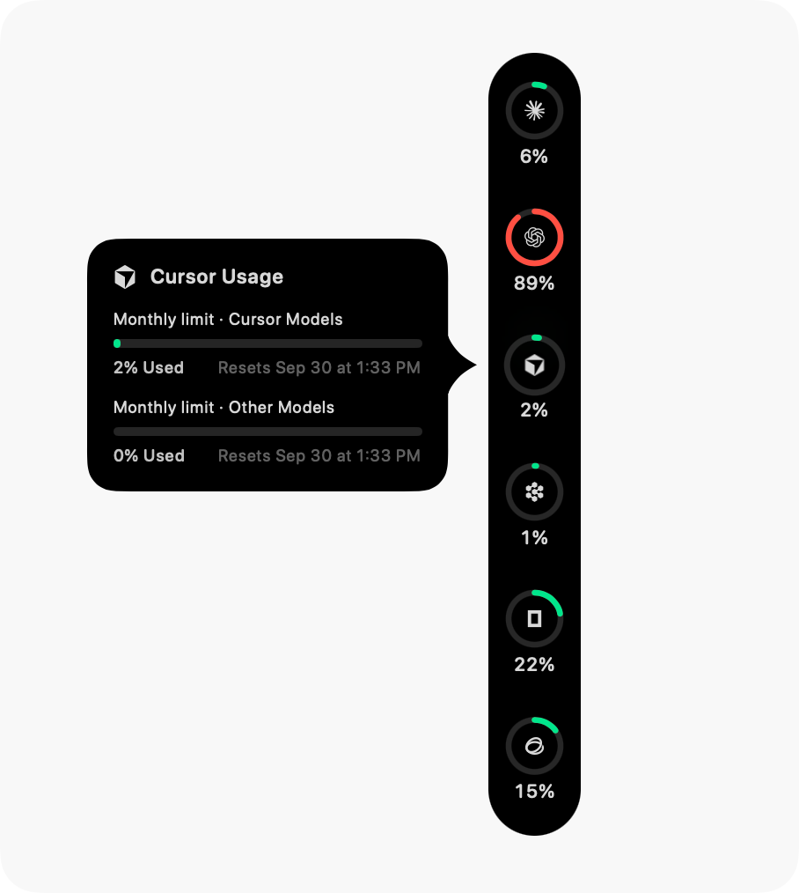
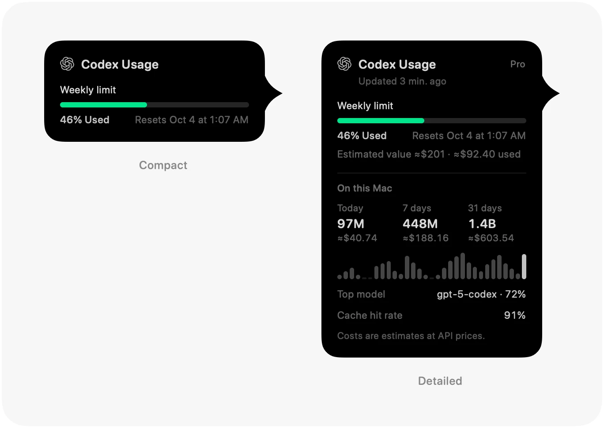

<p align="center">
  
</p>

<h1 align="center">Agent Wallet</h1>

<p align="center">
  <b>AI 연산 자원을 위한 지갑. 코딩 한도와 API 잔액이 얼마나 남았는지 화면 가장자리에서 한눈에 확인하세요.</b><br>
  이미 쓰고 있는 계정을 읽어 계정마다 링 하나로 보여 주는 macOS 앱입니다. 남은 양을 먼저 보여 주고, 한도와 잔액은 열을 나누어 나란히 놓습니다.
</p>

<p align="center">
  <a href="LICENSE"></a>
  
  <a href="https://github.com/Violet-Amethyst/agent-wallet/commits"></a>
</p>

<p align="center">
  <sub><b>macOS 14 Sonoma 이상</b> · Apple 실리콘 및 Intel 겸용 · <a href="README.md"><b>English</b></a> · <a href="README.zh-CN.md"><b>简体中文</b></a> · <a href="README.zh-Hant.md"><b>繁體中文</b></a> · <a href="README.ja.md"><b>日本語</b></a> · <b>한국어</b></sub>
</p>

<p align="center">
  
  &nbsp;&nbsp;
  
</p>

<p align="center">
  <sub>스크린샷은 Pulse를 기반으로 하던 시점의 것입니다. 이 프로젝트의 Dock은 남은 양으로 표시하고 한도와 잔액을 나누어 배치합니다(아래 참조).</sub>
</p>

## 소개

Agent Wallet은 [Pulse](https://github.com/qunqin24/Pulse)의 소스를 바탕으로 개인이 독립적으로 관리하는 프로젝트입니다. 사용량을 읽는 방식은 Pulse를 그대로 따릅니다. 각 서비스의 자체 엔드포인트와 이미 있는 로그인을 사용하며, 우리 서버로는 아무것도 보내지 않습니다. 바뀐 것은 숫자를 보여 주는 방식과 읽을 수 있는 계정의 종류입니다.

- **남은 양이 먼저** — Dock은 앞으로 쓸 수 있는 양을 보여 줍니다. 짧은 구간(약 5시간)은 안쪽 링, 긴 구간(일주일 또는 한 달)은 바깥쪽 링이며, 링 아래의 글자가 남은 양입니다.
- **한도와 잔액을 다른 열에** — 구독 한도는 한쪽에, 선불 또는 종량제 잔액은 다른 쪽에 놓습니다. 구분선을 둔 한 열로 바꿀 수도 있습니다. **설정 › 모양 › 열 레이아웃**에서 전환합니다.
- **구독 외의 계정** — Admin 키로 읽는 OpenAI API 비용, xAI 개발자 플랫폼(선불 잔액과 사용량), 웹 로그인으로 읽는 DeepSeek, Qoder CN 데스크톱 세션.
- **실제 숫자만** — 백분율은 서비스가 보고한 값만 사용합니다. 서비스가 보고하지 않거나 추정만 가능할 때는 짐작한 값을 그리지 않고 그 사실을 알립니다.
- **Dock의 동작 키** — 설정과 종료가 레일 끝에 놓입니다.
- **나머지는 Pulse 그대로** — 76개 서비스, 로컬 클라이언트의 토큰 사용량, 사용량 요약, 직접 고르는 알림, 서비스별 여러 계정, `--json` 출력, 6개 표시 언어.

[전체 설명](Docs/features.md) · [Pulse와의 차이, 그리고 업스트림을 병합할 때 지켜야 할 동작](Docs/agent-wallet-identity.md)

---

## 설치

패키지로 배포된 릴리스는 아직 없으므로 Agent Wallet은 소스에서 빌드합니다.

1. 명령줄 도구만이 아니라 전체 **Xcode**(**macOS 26 SDK** 포함)를 설치합니다. 앱 자체는 **macOS 14 이상**에서 실행됩니다.
2. 클론하고 번들을 만듭니다.

   ```bash
   git clone https://github.com/Violet-Amethyst/agent-wallet.git
   cd agent-wallet
   ./Scripts/bundle.sh
   open build.noindex/Pulse.app
   ```

   실행 파일과 번들의 이름은 당분간 Pulse 그대로입니다. 화면에서 제품 이름이 나오는 곳에는 Agent Wallet이라고 표시됩니다(Dock의 **Agent Wallet 종료** 등).
3. 처음 실행하면 모니터링할 서비스를 고릅니다. 모두 선택되지 않은 상태로 시작하며, **「완료」**를 누르기 전에는 자격 증명을 읽거나 사용량을 확인하지 않습니다. 나중에 설정에서 켤 수도 있습니다.
4. 앱은 메뉴 막대에 상주합니다. 레일을 오른쪽 클릭하고 **「설정…」**을 고르거나, **설정 › 일반 › 단축키**에서 전역 단축키를 지정하세요.

> [!NOTE]
> 빌드한 앱을 다른 Mac으로 복사하면 Apple Developer 인증서가 없어서 Gatekeeper가 막을 수 있습니다. **시스템 설정 → 개인정보 보호 및 보안**을 열어 **「무시하고 열기」**를 클릭하거나, 앱에 `xattr -cr`을 실행하세요.
>
> 현재는 Pulse와 같은 bundle id를 쓰므로, 이 빌드와 공식 Pulse를 함께 쓰면 설정을 공유합니다.

`swift run Pulse`로 번들 없이 빌드해 실행할 수 있지만, 알림은 번들로 만든 앱에서만 동작합니다. 툴체인 설명은 [Docs/build-from-source.md](Docs/build-from-source.md), 일상적인 개발과 동기화는 [Docs/local-development.md](Docs/local-development.md)를 참고하세요.

---

## 기능

- **링** — 사용량에 따라 변하는 색, 「사용」과 「남음」 전환, 구간이 얼마나 지났는지 보여 주는 시계 호, 에이전트가 작업하는 동안 도는 점.
- **카드** — 각 한도와 초기화 시각, 요금제, 읽은 시각, 그리고 지금 속도라면 어느 한도가 먼저 바닥나는지 알려 주는 소모 속도 예측.
- **위치** — 화면의 어느 가장자리든, Dock 옆이든, 메뉴 막대든. 유휴 상태에서는 가는 선으로 접힙니다.
- **알림** — 한도가 기준선을 넘었을 때, 다 썼을 때, 초기화되었을 때, 확인이 실패했을 때, 잔액이 부족할 때, 서비스 장애. 모두 기본값은 꺼짐입니다.
- **토큰 사용량** — 로컬 클라이언트가 쓴 양을 공개 API 가격으로 환산해 날짜·모델·에이전트별로 보여 줍니다. 추정 금액은 선택한 통화로 표시할 수 있습니다.
- **요약** — 일·주·월·연 단위로 공유할 수 있는 카드.
- **연결 진단** — 각 수치를 어디서 가져왔는지, 그리고 서버가 직접 보낸 응답.

<p align="center">
  
</p>

---

## 지원 서비스

76개 서비스를 각 제품이 동작하는 방식 그대로 읽습니다. 자체 사용량 엔드포인트, 편집기의 로그인, 로컬 언어 서버, 또는 붙여 넣은 키입니다. [전체 목록과 서비스별 읽는 방법](Docs/supported-services.md).

---

## 개인정보 보호

- **우리 쪽 계정도 서버도 없습니다** — Mac이 사용 중인 서비스와 본인의 로그인으로 직접 통신합니다.
- **모든 연결을 목록으로 공개합니다** — 해당 서비스, 공개 상태 페이지, 모델 가격을 위한 [models.dev](https://models.dev), 달러 외 통화를 고른 경우에만 쓰는 [ExchangeRate-API](https://www.exchangerate-api.com), 업데이트를 위한 GitHub.
- **키는 Mac 안에** 암호화되어 저장되며, 읽어 온 사용량 기록은 Mac 밖으로 나가지 않습니다.

[자세히](Docs/features.md#privacy-and-security).

---

## 기여하기

저장소에서 문서를 관리하는 방식, 후퇴해서는 안 되는 동작, 해당 페이지를 갱신하는 방법은 [CONTRIBUTING.md](CONTRIBUTING.md)를 참고하세요. 주제별 문서 목록은 [Docs/README.md](Docs/README.md)입니다.

---

## 크레딧과 라이선스

Agent Wallet은 qunqin24와 기여자들의 [**Pulse**](https://github.com/qunqin24/Pulse)에서 파생되었으며, 서비스 파싱 코드에는 Peter Steinberger와 기여자들의 [**CodexBar**](https://github.com/steipete/CodexBar)(MIT)를 고쳐 쓴 부분이 있습니다. Pulse의 인터페이스는 [**Vinz**(@hivinz_)](https://x.com/hivinz_/status/2092996055248126353)가 공유한 콘셉트에서 영감을 받았습니다. 이 프로젝트는 독립적인 파생물이며 Pulse, CodexBar 또는 지원 서비스의 공식 릴리스가 아니고, 위 저자들은 이에 책임을 지지 않습니다.

[Apache 2.0](LICENSE)으로 배포됩니다. 유지되는 고지와 포함된 서드파티 자산은 [NOTICE](NOTICE)와 [THIRD_PARTY_NOTICES.md](THIRD_PARTY_NOTICES.md)를 참고하세요.
