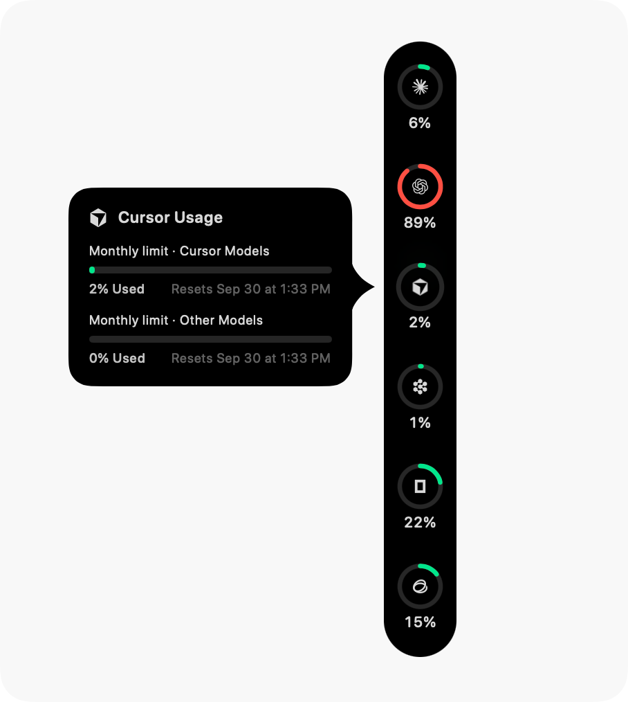
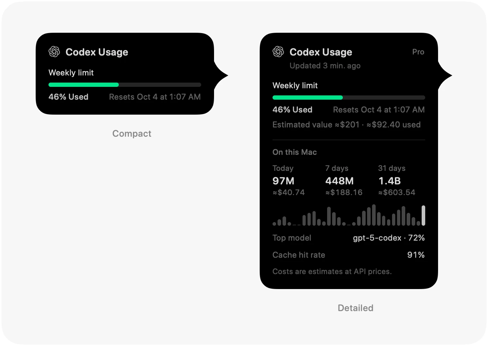

<p align="center">
  
</p>

<h1 align="center">Agent Wallet</h1>

<p align="center">
  <b>A wallet for your AI compute: what is left of every coding quota and API balance, on the edge of your screen.</b><br>
  A macOS app that reads the accounts you already use and shows each one as a ring — remaining first, quota and balance side by side.
</p>

<p align="center">
  <a href="LICENSE"></a>
  
  <a href="https://github.com/Violet-Amethyst/agent-wallet/commits"></a>
</p>

<p align="center">
  <sub><b>macOS 14 Sonoma or newer</b> · Apple Silicon & Intel · <b>English</b> · <a href="README.zh-CN.md"><b>简体中文</b></a> · <a href="README.zh-Hant.md"><b>繁體中文</b></a> · <a href="README.ja.md"><b>日本語</b></a> · <a href="README.ko.md"><b>한국어</b></a></sub>
</p>

<p align="center">
  
  &nbsp;&nbsp;
  
</p>

<p align="center">
  <sub>Screenshots are from the Pulse base. The dock in this project reads remaining quota and splits quota from balance, as described below.</sub>
</p>

## What it is

Agent Wallet is a personal, independently maintained project built on the source of [Pulse](https://github.com/qunqin24/Pulse). It keeps Pulse's way of reading usage — the services' own endpoints, your existing logins, nothing sent to a server of ours — and changes how the numbers are shown and which accounts can be read.

- **Remaining first** — the dock shows what you can still spend. The short window (about five hours) is the inner ring and the long one (a week or a month) is the outer ring; the label under a ring is what is left.
- **Quota and balance in separate columns** — subscription limits sit on one side and prepaid or pay-as-you-go balances on the other, or in one column with a divider if you prefer. Switch under **Settings › Appearance › Rail columns**.
- **Accounts beyond the subscription plans** — OpenAI API costs through an Admin key, the xAI developer platform (prepaid balance and usage), DeepSeek through its web login, and the Qoder CN desktop session.
- **Real numbers only** — a percentage is one the service reported. Where it reports nothing, or an estimate is the best available, the app says so instead of drawing a guess.
- **Action keys on the dock** — Settings and Quit sit at the end of the rail.
- **Everything else from Pulse** — seventy-six services, Token spend from local clients, usage recaps, notifications you choose, several accounts per provider, `--json` output and six interface languages.

[Everything in detail](Docs/features.md) · [What differs from Pulse, and what must survive an upstream merge](Docs/agent-wallet-identity.md)

---

## Installation

There are no packaged releases yet, so Agent Wallet is built from source.

1. Install the full **Xcode** (not only the Command Line Tools) with the **macOS 26 SDK**. The app runs on **macOS 14+**.
2. Clone and bundle:

   ```bash
   git clone https://github.com/Violet-Amethyst/agent-wallet.git
   cd agent-wallet
   ./Scripts/bundle.sh
   open build.noindex/Pulse.app
   ```

   The executable and the bundle keep the name Pulse for now; the app itself says Agent Wallet where the product is named, such as **Quit Agent Wallet** on the dock.
3. On first launch, choose the services to monitor. All start unchecked; credentials are read and usage is checked only after you click **Done**. You can enable a service later in Settings.
4. The app lives in the menu bar. Right-click the rail and choose **Settings…**, or assign a global shortcut under **Settings › General › Shortcuts**.

> [!NOTE]
> A build copied to another Mac may be blocked by Gatekeeper, because it carries no Apple Developer certificate. Open **System Settings → Privacy & Security** and click **Open Anyway**, or run `xattr -cr` on the app.
>
> The Pulse bundle identifier is shared, so running this build and the official Pulse side by side makes them share one set of settings.

`swift run Pulse` builds and runs without a bundle, but notifications work only from the bundled app. Toolchain details: [Docs/build-from-source.md](Docs/build-from-source.md). Day-to-day development and syncing: [Docs/local-development.md](Docs/local-development.md).

---

## Features

- **Rings** — colours that follow usage, used-or-left wording, a clock arc for how much of the window has passed, and a turning dot while an agent works.
- **Cards** — every limit and its reset, the plan, when it was read, and a burn-rate forecast that says when your pace will run out first.
- **Placement** — any screen edge, beside the Dock, or the menu bar; it folds to a sliver when idle.
- **Notifications** — a limit crossing a line, spent, reset, failing checks, a low balance, a provider outage. All off by default.
- **Token spend** — what local clients have used, priced at public API rates, by day, model and agent, with estimates in the currency you pick.
- **Recaps** — shareable cards for a day, a week, a month or a year.
- **Diagnostics** — where each figure came from, and the servers' own replies.

<p align="center">
  
</p>

---

## Supported services

Seventy-six services, each read the way the product itself works — its own usage endpoint, the editor's login, a local language server, or a key you paste. [The full list, and how each is read](Docs/supported-services.md).

---

## Privacy

- **No account with us, no server of ours** — your Mac talks to the services you use, under your own logins.
- **Every connection is listed** — those services, their public status pages, [models.dev](https://models.dev) for model prices, [ExchangeRate-API](https://www.exchangerate-api.com) only when you choose a currency other than the dollar, and GitHub for updates.
- **Your keys stay on your Mac**, encrypted, and the usage records it reads never leave it.

[In detail](Docs/features.md#privacy-and-security).

---

## Contributing

How the repo is documented, what must not regress, and how to update the right page: [CONTRIBUTING.md](CONTRIBUTING.md). Map of topic docs: [Docs/README.md](Docs/README.md).

---

## Credits and license

Agent Wallet is derived from [**Pulse**](https://github.com/qunqin24/Pulse) by qunqin24 and contributors, and its provider parsing includes adaptations of [**CodexBar**](https://github.com/steipete/CodexBar) by Peter Steinberger and contributors (MIT). Pulse's interface was inspired by a concept shared by [**Vinz** (@hivinz_)](https://x.com/hivinz_/status/2092996055248126353). This is an independent derivative, not an official release of Pulse, CodexBar or any supported service, and none of their authors is responsible for it.

Licensed under [Apache 2.0](LICENSE); see [NOTICE](NOTICE) and [THIRD_PARTY_NOTICES.md](THIRD_PARTY_NOTICES.md) for the retained notices and bundled third-party assets.
