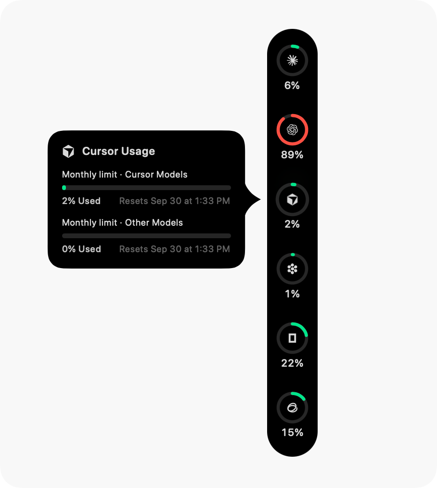
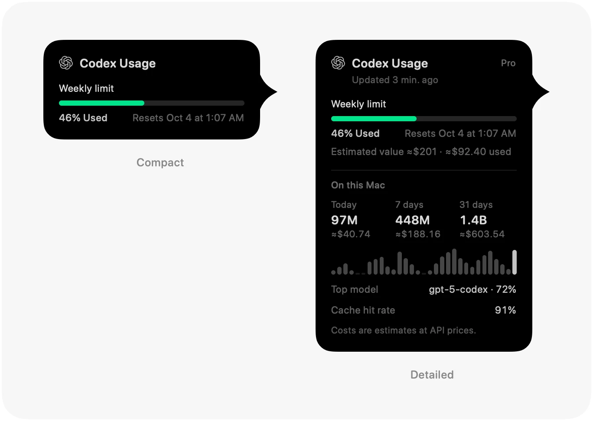

<p align="center">
  
</p>

<h1 align="center">Agent Wallet</h1>

<p align="center">
  <b>AI 算力的钱包：每个编程额度和 API 余额还剩多少，贴在屏幕边上看。</b><br>
  一个 macOS 应用，读取你已有的账号，每个账号一枚圆环——先看剩余，额度和余额分列并排。
</p>

<p align="center">
  <a href="LICENSE"></a>
  
  <a href="https://github.com/Violet-Amethyst/agent-wallet/commits"></a>
</p>

<p align="center">
  <sub><b>macOS 14 Sonoma 或更高版本</b> · Apple 芯片与 Intel 通用 · <a href="README.md"><b>English</b></a> · <b>简体中文</b> · <a href="README.zh-Hant.md"><b>繁體中文</b></a> · <a href="README.ja.md"><b>日本語</b></a> · <a href="README.ko.md"><b>한국어</b></a></sub>
</p>

<p align="center">
  
  &nbsp;&nbsp;
  
</p>

<p align="center">
  <sub>截图取自 Pulse 基线版本。本项目的坞按剩余量读数，并把额度与余额分开排列，见下文。</sub>
</p>

## 这是什么

Agent Wallet 是一个个人独立维护的项目，建立在 [Pulse](https://github.com/qunqin24/Pulse) 的源码之上。它沿用 Pulse 读取用量的方式——直接访问各服务商自己的接口，使用你已有的登录，不向我们的服务器发送任何东西——改变的是数字的呈现方式，以及能读取哪些账号。

- **先看剩余**——坞上显示还能用多少。短窗口（约五小时）是内环，长窗口（一周或一个月）是外环，环下的文字是剩余量。
- **额度与余额分列**——订阅额度排在一侧，预付或按量计费的余额排在另一侧；也可以改成单列，中间用分隔线隔开。在 **设置 › 外观 › 栏数布局** 中切换。
- **订阅之外的账号**——通过 Admin 密钥读取 OpenAI API 费用，读取 xAI 开发者平台（预付余额与用量），通过网页登录读取 DeepSeek，以及 Qoder CN 桌面会话。
- **只显示真实数字**——百分比必须是服务商报告的。服务商没有报告、或只能给出估算时，应用会如实说明，不画猜出来的数字。
- **坞上的操作键**——设置和退出放在圆环栏的末端。
- **其余沿用 Pulse**——七十六个服务商、本地客户端的 Token 消耗、用量回顾、自己选择的通知、每个服务商多个账号、`--json` 输出，以及六种界面语言。

[完整说明](Docs/features.md) · [与 Pulse 的差异，以及合并上游时必须保住的行为](Docs/agent-wallet-identity.md)

---

## 安装

目前没有打包好的发行版，Agent Wallet 需要从源码构建。

1. 安装完整的 **Xcode**（不能只装命令行工具），并包含 **macOS 26 SDK**。应用本身可在 **macOS 14+** 上运行。
2. 克隆并打包：

   ```bash
   git clone https://github.com/Violet-Amethyst/agent-wallet.git
   cd agent-wallet
   ./Scripts/bundle.sh
   open build.noindex/Pulse.app
   ```

   可执行文件和 app 包暂时仍叫 Pulse；界面中出现产品名的地方写的是 Agent Wallet，例如坞上的 **退出 Agent Wallet**。
3. 首次启动先选择要监控的服务，默认都不勾选。点 **「完成」** 后才会读取凭据并查询用量，之后也可以在设置里开启。
4. 应用常驻菜单栏。右键圆环栏并选择 **「设置…」**，也可以在 **设置 › 通用 › 快捷键** 里分配全局快捷键。

> [!NOTE]
> 把构建好的 app 拷到另一台 Mac 上时，可能被 Gatekeeper 拦截，因为它没有 Apple 开发者证书。打开 **系统设置 → 隐私与安全性**，点击 **“仍要打开”**，或对该 app 运行 `xattr -cr`。
>
> 目前的 bundle id 与 Pulse 相同，所以这个构建和官方 Pulse 同时使用时，会共用同一套设置。

`swift run Pulse` 不打包也能构建运行，但通知只有在打包后的 app 里才可用。工具链说明见 [Docs/build-from-source.md](Docs/build-from-source.md)，日常开发与同步见 [Docs/local-development.md](Docs/local-development.md)。

---

## 功能

- **圆环**——颜色随用量变化，可选「已用」或「剩余」，用时钟弧显示窗口已过去多少，代理工作时有一个转动的圆点。
- **卡片**——每项额度及其重置时间、套餐、读取时间，以及消耗速度预测：按当前节奏，哪个额度会先用完。
- **位置**——屏幕任意一边、程序坞旁边或菜单栏；闲置时收成一条细线。
- **通知**——额度越过某条线、用完、重置、检查失败、余额不足、服务商故障。全部默认关闭。
- **Token 消耗**——本地客户端用掉了多少，按公开 API 价格计价，可按天、模型和代理查看，估算金额可换成你选的货币。
- **回顾**——按天、周、月或年生成可分享的卡片。
- **连接诊断**——每个数字来自哪里，以及服务器的原始回复。

<p align="center">
  
</p>

---

## 支持的服务

七十六个服务，每个都按产品自己的方式读取——它自己的用量接口、编辑器的登录、本地语言服务器，或者你粘贴的密钥。[完整列表及各自的读取方式](Docs/supported-services.md)。

---

## 隐私

- **没有我们的账号，也没有我们的服务器**——你的 Mac 直接访问你用的服务，使用你自己的登录。
- **所有连接都有列出**——这些服务、它们的公开状态页、用于模型价格的 [models.dev](https://models.dev)、只在你选了美元以外货币时才访问的 [ExchangeRate-API](https://www.exchangerate-api.com)，以及用于更新的 GitHub。
- **密钥留在你的 Mac 上**，加密保存，读取到的用量记录不会离开这台电脑。

[详细说明](Docs/features.md#privacy-and-security)。

---

## 参与贡献

仓库如何记录文档、哪些行为不能退化、如何更新对应的文档：见 [CONTRIBUTING.md](CONTRIBUTING.md)。各主题文档的索引：[Docs/README.md](Docs/README.md)。

---

## 致谢与许可

Agent Wallet 派生自 qunqin24 及贡献者的 [**Pulse**](https://github.com/qunqin24/Pulse)，其服务商解析包含对 Peter Steinberger 及贡献者的 [**CodexBar**](https://github.com/steipete/CodexBar)（MIT）的改写。Pulse 的界面灵感来自 [**Vinz**（@hivinz_）](https://x.com/hivinz_/status/2092996055248126353) 分享的设计构想。本项目是独立的衍生作品，不是 Pulse、CodexBar 或任何受支持服务的官方发行版，上述作者对它不承担责任。

采用 [Apache 2.0](LICENSE) 许可；保留的声明和内置的第三方资源见 [NOTICE](NOTICE) 与 [THIRD_PARTY_NOTICES.md](THIRD_PARTY_NOTICES.md)。
