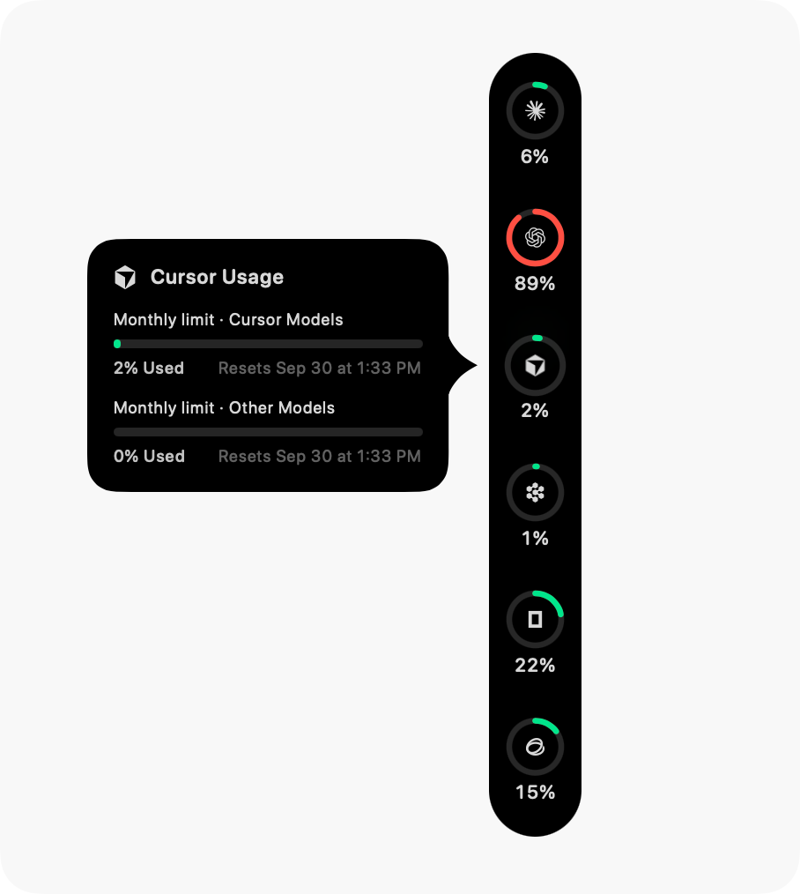
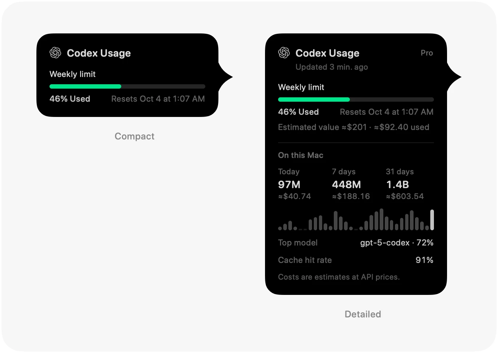

<p align="center">
  
</p>

<h1 align="center">Agent Wallet</h1>

<p align="center">
  <b>AI 算力的錢包：每個程式設計額度與 API 餘額還剩多少，貼在螢幕邊緣就能看。</b><br>
  一個 macOS App，讀取你已有的帳號，每個帳號一枚圓環——先看剩餘，額度與餘額分欄並列。
</p>

<p align="center">
  <a href="LICENSE"></a>
  
  <a href="https://github.com/Violet-Amethyst/agent-wallet/commits"></a>
</p>

<p align="center">
  <sub><b>macOS 14 Sonoma 或更新版本</b> · Apple 晶片與 Intel 通用 · <a href="README.md"><b>English</b></a> · <a href="README.zh-CN.md"><b>简体中文</b></a> · <b>繁體中文</b> · <a href="README.ja.md"><b>日本語</b></a> · <a href="README.ko.md"><b>한국어</b></a></sub>
</p>

<p align="center">
  
  &nbsp;&nbsp;
  
</p>

<p align="center">
  <sub>截圖取自 Pulse 基線版本。本專案的 Dock 以剩餘量顯示，並把額度與餘額分開排列，詳見下文。</sub>
</p>

## 這是什麼

Agent Wallet 是個人獨立維護的專案，建立在 [Pulse](https://github.com/qunqin24/Pulse) 的原始碼之上。它沿用 Pulse 讀取用量的方式——直接存取各服務商自己的介面，使用你已有的登入，不向我們的伺服器傳送任何東西——改變的是數字的呈現方式，以及可以讀取哪些帳號。

- **先看剩餘**——Dock 上顯示還能用多少。短視窗（約五小時）是內環，長視窗（一週或一個月）是外環，環下的文字是剩餘量。
- **額度與餘額分欄**——訂閱額度排在一側，預付或按量計費的餘額排在另一側；也可以改成單欄，中間以分隔線區隔。在 **設定 › 外觀 › 欄數佈局** 中切換。
- **訂閱以外的帳號**——透過 Admin 金鑰讀取 OpenAI API 費用，讀取 xAI 開發者平台（預付餘額與用量），透過網頁登入讀取 DeepSeek，以及 Qoder CN 桌面工作階段。
- **只顯示真實數字**——百分比必須是服務商回報的。服務商沒有回報、或只能提供估算時，App 會如實說明，不畫猜出來的數字。
- **Dock 上的操作鍵**——設定與結束放在圓環列的末端。
- **其餘沿用 Pulse**——七十六個服務商、本機用戶端的 Token 消耗、用量回顧、自己選擇的通知、每個服務商多個帳號、`--json` 輸出，以及六種介面語言。

[完整說明](Docs/features.md) · [與 Pulse 的差異，以及合併上游時必須保住的行為](Docs/agent-wallet-identity.md)

---

## 安裝

目前沒有打包好的發行版，Agent Wallet 需要從原始碼建置。

1. 安裝完整的 **Xcode**（不能只裝命令列工具），並包含 **macOS 26 SDK**。App 本身可在 **macOS 14+** 上執行。
2. 複製並打包：

   ```bash
   git clone https://github.com/Violet-Amethyst/agent-wallet.git
   cd agent-wallet
   ./Scripts/bundle.sh
   open build.noindex/Pulse.app
   ```

   執行檔與 App 套件暫時仍叫 Pulse；介面中出現產品名稱的地方寫的是 Agent Wallet，例如 Dock 上的 **結束 Agent Wallet**。
3. 首次啟動時，先選擇要監控的服務，預設全部不勾選。按 **「完成」** 後才會讀取憑證並查詢用量，之後也可以在設定中開啟。
4. App 常駐選單列。右鍵點按圓環列並選擇 **「設定…」**，也可以在 **設定 › 一般 › 快速鍵** 中指派全域快速鍵。

> [!NOTE]
> 把建置好的 App 複製到另一部 Mac 時，可能被 Gatekeeper 攔截，因為它沒有 Apple 開發者憑證。請開啟 **系統設定 → 隱私權與安全性**，點按 **「強制打開」**，或對該 App 執行 `xattr -cr`。
>
> 目前的 bundle id 與 Pulse 相同，所以這個建置與官方 Pulse 同時使用時，會共用同一套設定。

`swift run Pulse` 不打包也能建置並執行，但通知只有在打包後的 App 中才能使用。工具鏈說明見 [Docs/build-from-source.md](Docs/build-from-source.md)，日常開發與同步見 [Docs/local-development.md](Docs/local-development.md)。

---

## 功能

- **圓環**——顏色隨用量變化，可選「已用」或「剩餘」，以時鐘弧顯示視窗已過去多少，代理工作時會有一個轉動的圓點。
- **卡片**——每項額度與其重置時間、方案、讀取時間，以及消耗速度預測：照目前的節奏，哪個額度會先用完。
- **位置**——螢幕任一邊、Dock 旁邊或選單列；閒置時收合成一條細線。
- **通知**——額度越過某條線、用完、重置、檢查失敗、餘額不足、服務商故障。全部預設關閉。
- **Token 消耗**——本機用戶端用掉了多少，依公開 API 價格計價，可依日、模型與代理檢視，估算金額可換成你選的貨幣。
- **回顧**——依日、週、月或年產生可分享的卡片。
- **連線診斷**——每個數字來自哪裡，以及伺服器的原始回應。

<p align="center">
  
</p>

---

## 支援的服務

七十六個服務，每個都依產品自己的方式讀取——它自己的用量介面、編輯器的登入、本機語言伺服器，或你貼上的金鑰。[完整清單及各自的讀取方式](Docs/supported-services.md)。

---

## 隱私

- **沒有我們的帳號，也沒有我們的伺服器**——你的 Mac 直接連到你使用的服務，使用你自己的登入。
- **所有連線都有列出**——這些服務、它們的公開狀態頁、用於模型價格的 [models.dev](https://models.dev)、只在你選了美元以外貨幣時才連線的 [ExchangeRate-API](https://www.exchangerate-api.com)，以及用於更新的 GitHub。
- **金鑰留在你的 Mac 上**，加密保存，讀取到的用量記錄不會離開這部電腦。

[詳細說明](Docs/features.md#privacy-and-security)。

---

## 參與貢獻

儲存庫如何記錄文件、哪些行為不能退化、如何更新對應的文件：見 [CONTRIBUTING.md](CONTRIBUTING.md)。各主題文件的索引：[Docs/README.md](Docs/README.md)。

---

## 致謝與授權

Agent Wallet 衍生自 qunqin24 與貢獻者的 [**Pulse**](https://github.com/qunqin24/Pulse)，其服務商解析包含對 Peter Steinberger 與貢獻者的 [**CodexBar**](https://github.com/steipete/CodexBar)（MIT）的改寫。Pulse 的介面靈感來自 [**Vinz**（@hivinz_）](https://x.com/hivinz_/status/2092996055248126353) 分享的設計構想。本專案是獨立的衍生作品，不是 Pulse、CodexBar 或任何受支援服務的官方發行版，上述作者對它不負責任。

採用 [Apache 2.0](LICENSE) 授權；保留的聲明與內建的第三方資源見 [NOTICE](NOTICE) 與 [THIRD_PARTY_NOTICES.md](THIRD_PARTY_NOTICES.md)。
